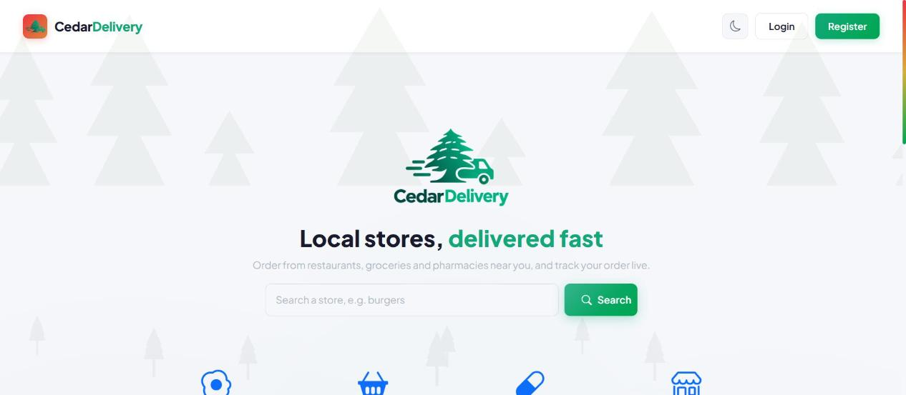
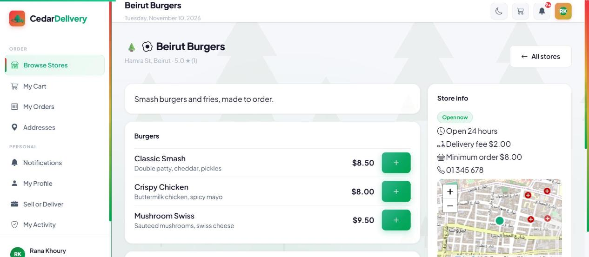
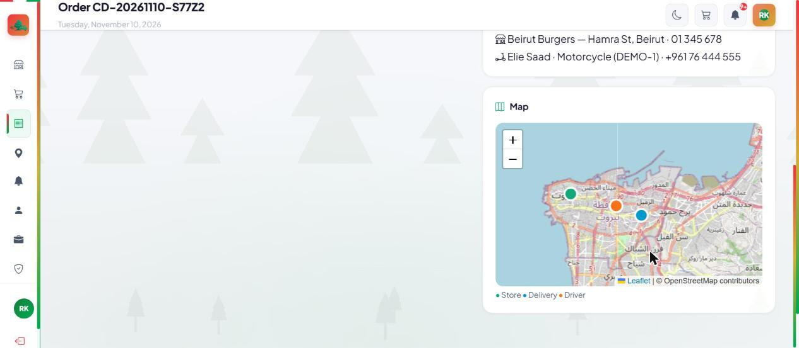
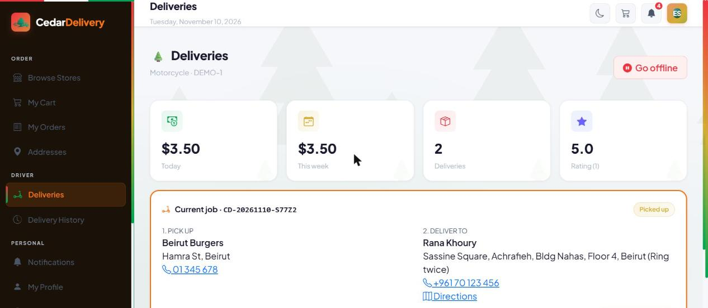
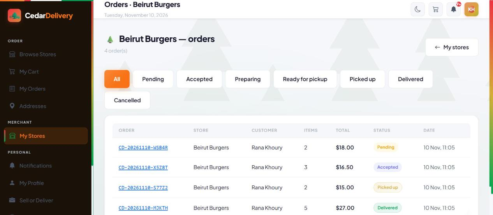
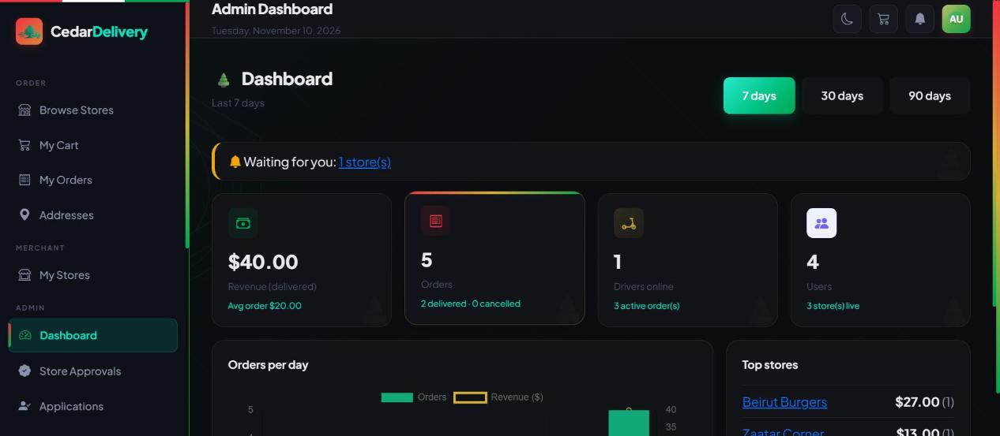

<p align="center">
  
</p>

<p align="center">
  <strong>A delivery marketplace for Lebanon.</strong><br/>
  Customers order from local restaurants, groceries and pharmacies, stores prepare the orders,
  drivers deliver them, and everyone follows the order live.
</p>

<p align="center">
  ASP.NET Core 9 · Entity Framework Core · SQL Server · ASP.NET Identity · SignalR · Bootstrap 5 · Leaflet · MailKit
</p>

---

## Screenshots

| Home | Store menu |
|---|---|
|  |  |
| **Order on its way (live map)** | **Driver** |
|  |  |
| **Merchant orders** | **Admin dashboard** |
|  |  |

## Features

**Customers**
- Browse and search stores by category, see menus, opening hours and ratings
- Cart (one store per cart), saved addresses with a map pin, checkout with cash on delivery
- Live order page: status timeline, driver details, and the driver moving on a map
- Rate the store and the driver after delivery
- Notifications in the app (live) and by email for important events

**Merchants**
- Create stores (approved by an admin), set hours, delivery fee and minimum order
- Manage the menu: categories, products, hide items that are out of stock
- Order queue with status tabs: accept or reject, preparing, ready for pickup
- New orders appear instantly, no refresh needed

**Drivers**
- Go online, see orders waiting for a driver, accept one job at a time
- Pick up, deliver, collect cash; earnings for today, this week and all time
- Location is shared while online, so the customer sees the driver approach

**Admins**
- Dashboard: revenue, orders per day (chart), top stores, drivers online
- Approve stores and merchant/driver applications
- Manage users (deactivating a user signs them out, takes a driver offline and closes their stores)
- See every order and the activity log

**Everyone**
- Email/password or Google sign-in, email confirmation and password reset
- Dark mode, responsive layout, same look as [CedarPay](https://github.com/Edwinuniv/CedarPay)

## How an order moves

```
Customer places order ─► Pending ─► Accepted ─► Preparing ─► ReadyForPickup ─► PickedUp ─► Delivered
                           │  (store)                          (driver accepts)   (driver)    (driver, cash paid)
                           ├─► Rejected  (store)
                           └─► Cancelled (customer while Pending, admin until pickup)
```

All transitions live in one place, [`Services/OrderStatusRules.cs`](Services/OrderStatusRules.cs), and every change is saved in the
order's timeline. If two drivers press "Accept" at the same moment, a unique index on `Deliveries.OrderId` lets only one win.

## Architecture

The project follows the same structure as CedarPay:

```
ApiControllers/   REST API (/api/...), JSON in and out
Controllers/      MVC pages (Razor views)
Hubs/             SignalR hub for live updates
Services/         Business rules (interfaces + implementations)
Repositories/     Data access on top of EF Core (GenericRepository + one per entity)
Data/             ApplicationDbContext, role and user seeders
Models/           Entities (tables)
ViewModels/       Page models and API DTOs (ViewModels/Api)
Areas/Identity/   Login, register, Google sign-in pages
Views/, wwwroot/  Razor views, CSS, JS, images
```

A request goes **Controller → Service → Repository → DbContext**:

- **Controllers stay thin.** The MVC pages and the REST API call the *same* services, so a rule
  (ownership, status flow, minimum order...) is written once and applies everywhere.
- **Services throw on purpose** (`NotFoundException`, `ForbiddenException`, `BadRequestException`).
  `ApiExceptionFilter` turns them into one JSON error format; `AppExceptionPageFilter` turns them into
  a 404 page, the Access Denied page or a message on the page.
- **Repositories** hide EF Core queries from the rest of the app.
- **Notifications** go through one method (`NotificationService.NotifyAsync`) that saves them,
  pushes them live with SignalR and, for important events, sends an email.

## REST API

All endpoints are under `/api`, documented with Swagger at **`/swagger`** (development mode).
List endpoints are paginated (`?page=1&pageSize=10`, max 50) and errors always look like:

```json
{ "success": false, "message": "The store can open after an admin approves it.", "errors": [] }
```

| Area | Endpoints |
|---|---|
| Stores | `GET /api/stores`, `GET /api/stores/{id}`, `GET /api/stores/{id}/menu`, `POST/PUT /api/stores`, `PATCH /api/stores/{id}/open`, `PATCH /api/stores/{id}/approval` |
| Menu | `/api/stores/{id}/categories`, `/api/stores/{id}/products`, `/api/categories/{id}`, `/api/products/{id}` |
| Cart & orders | `/api/cart`, `/api/cart/items`, `POST /api/orders`, `GET /api/orders/mine`, `GET /api/orders/{id}`, `PATCH /api/orders/{id}/status`, `POST /api/orders/{id}/cancel` |
| Deliveries | `/api/driver/profile`, `/api/driver/online`, `/api/deliveries/available`, `/api/deliveries/accept/{orderId}`, `/api/deliveries/{id}/pickup`, `/api/deliveries/{id}/deliver`, `/api/deliveries/earnings` |
| Other | `/api/addresses`, `/api/reviews`, `/api/notifications`, `/api/applications`, `/api/account/me`, `/api/admin/users`, `/api/admin/analytics`, `/api/admin/activity` |

## Getting started

**You need:** the [.NET 9 SDK](https://dotnet.microsoft.com/download/dotnet/9.0), SQL Server LocalDB
(installed with Visual Studio, or SQL Server Express) and the EF Core tool: `dotnet tool install --global dotnet-ef`.

```bash
git clone https://github.com/Edwinuniv/CedarDelivery.git
cd CedarDelivery

# Passwords for the four demo accounts (at least 6 characters, a digit, upper and lower case)
dotnet user-secrets set "Seed:AdminPassword"    "Admin123x"
dotnet user-secrets set "Seed:MerchantPassword" "Merchant123x"
dotnet user-secrets set "Seed:DriverPassword"   "Driver123x"
dotnet user-secrets set "Seed:CustomerPassword" "Customer123x"

dotnet ef database update
dotnet run --launch-profile https
```

Open **https://localhost:7232** and sign in with `admin@`, `merchant@`, `driver@` or `customer@cedardelivery.com`.
The connection string in `appsettings.json` uses LocalDB; change it for another SQL Server.

### Optional settings (user-secrets, never committed)

| Feature | Settings |
|---|---|
| Google sign-in | `Authentication:Google:ClientId`, `Authentication:Google:ClientSecret` (redirect URI: `https://localhost:7232/signin-google`) |
| Email (MailKit) | `Email:Username`, `Email:Password` (e.g. a Gmail app password). Host and port are in `appsettings.json`. |

Without them the app still runs: the Google button is hidden, emails are skipped (logged), and
email confirmation stays off.

## Security notes

- Roles and policies on every page and endpoint; users can only see and change their own data
  (someone else's order or address answers "not found").
- Anti-forgery tokens on every form; the JSON API returns 401/403 instead of redirecting.
- Account lockout after 5 failed logins; deactivated users are signed out within 5 minutes.
- Secrets live in user-secrets, not in the repository. Text from users is encoded in pages,
  toasts and emails.

## Not built (yet)

Card payments with Stripe (cash on delivery only for now), promo codes and an AI product-description helper
were listed as extras in [REQUIREMENTS.md](REQUIREMENTS.md).

---

Built by **Edwin Mouawad**, Computer Science student at INCI-USJ, Lebanon.
